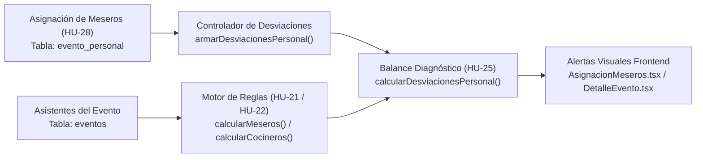
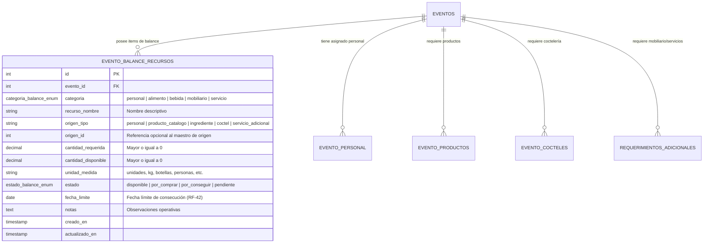

# Diseño Técnico: Modelo de Datos del Balance Logístico y Conexión HU-25 / HU-28

**Proyecto:** SIGEV (Sistema de Gestión de Eventos)  
**Sprint:** 4  
**Tarea asociada:** Conectar HU-25 con los meseros asignados y diseñar el modelo de datos del balance ([04_Plan_de_Entregas_y_Sprints_SIGEV_v2_6.md](04_Plan_de_Entregas_y_Sprints_SIGEV_v2_6.md#L347))  
**Responsable:** Jhon  
**Propósito:** Cumplir los criterios de la **HU-25** (*Alertar desviaciones de personal*) y mitigar el **Riesgo R4** adelantando el diseño relacional y de contratos para la **Épica 6** (*Balance logístico: HU-31 a HU-35*).

---

## 1. Contexto y Objetivos

1. **Conexión HU-25 con meseros asignados (HU-28):**
   * En la versión previa, la HU-28 gestionaba la asignación física de personal a través de la tabla `evento_personal`.
   * La HU-25 (**RF-32**) requiere comparar en caliente (*runtime*) la dotación real asignada frente al estándar calculado según los asistentes ($1$ mesero por cada 20 asistentes, **RN-04**; y $2$ cocineros por cada 25 asistentes, **RN-05**).
   * Cuando se presenta una insuficiencia, el sistema debe alertar al responsable de logística indicando la cantidad exacta faltante.

2. **Diseño anticipado del Balance Logístico (Épica 6):**
   * El Sprint 5 no dispone de semana de integración antes de la entrega final (**Riesgo R4**).
   * Para evitar cuellos de botella en las historias HU-31 a HU-35 (**RF-39** a **RF-44**), se adelanta el modelo de datos relacional y de tipos para la integración de personal, alimentos, bebidas, mobiliario y servicios.

---

## 2. Conexión HU-25 / HU-28: Desviaciones de Personal

### 2.1. Arquitectura de Conexión



### 2.2. Reglas Matemáticas y Diagnóstico

* **Meseros Requeridos ($R_m$):**  
  $$R_m = \lceil \frac{\text{asistentes}}{20} \rceil \quad (\text{RN-04 / RF-28})$$
* **Cocineros Requeridos ($R_c$):**  
  $$R_c = \lceil \frac{\text{asistentes}}{25} \rceil \times 2 \quad (\text{RN-05 / RF-29})$$
* **Diferencia por Rol ($D$):**  
  $$D = \text{Asignados} - \text{Requeridos}$$
* **Déficit ($Def$):**  
  $$Def = \max(0, -D)$$
* **Estado por Rol:**  
  $$\text{Estado} = \begin{cases} \text{'DEFICIT'} & \text{si } D < 0 \\ \text{'OK'} & \text{si } D = 0 \\ \text{'SURPLUS'} & \text{si } D > 0 \end{cases}$$

---

## 3. Modelo de Datos del Balance Logístico (Épica 6)

### 3.1. Requerimientos Funcionales Cubiertos

* **RF-39:** Generación automática del balance a partir de los datos del evento.
* **RF-40:** Integración de personal, alimentos, bebidas, mobiliario y servicios.
* **RF-41:** Estados normalizados: `disponible`, `por_comprar`, `por_conseguir`, `pendiente`. (*Aclaración: "comprado" no es estado; pasa directamente a "disponible"*).
* **RF-42:** Fecha límite para elementos pendientes.
* **RF-43:** Actualización manual a `disponible` por parte de logística (sin registro de facturas ni gastos contables).
* **RF-44:** Consulta anticipada de recursos faltantes (`WHERE estado != 'disponible'`).

### 3.2. Diagrama Entidad-Relación



### 3.3. Diccionario de Datos SQL (PostgreSQL)

```sql
-- Tipos enumerados
CREATE TYPE categoria_balance_enum AS ENUM (
    'personal',
    'alimento',
    'bebida',
    'mobiliario',
    'servicio'
);

CREATE TYPE estado_balance_enum AS ENUM (
    'disponible',
    'por_comprar',
    'por_conseguir',
    'pendiente'
);

-- Tabla principal de balance logístico por evento
CREATE TABLE IF NOT EXISTS evento_balance_recursos (
    id SERIAL PRIMARY KEY,
    evento_id INTEGER NOT NULL REFERENCES eventos(id) ON DELETE CASCADE,
    categoria categoria_balance_enum NOT NULL,
    recurso_nombre VARCHAR(150) NOT NULL,
    origen_tipo VARCHAR(30) CHECK (origen_tipo IN ('personal', 'producto_catalogo', 'ingrediente', 'coctel', 'servicio_adicional')),
    origen_id INTEGER,
    cantidad_requerida NUMERIC(10, 2) NOT NULL DEFAULT 0,
    cantidad_disponible NUMERIC(10, 2) NOT NULL DEFAULT 0,
    unidad_medida VARCHAR(30) NOT NULL DEFAULT 'unidades',
    estado estado_balance_enum NOT NULL DEFAULT 'pendiente',
    fecha_limite DATE,
    notas TEXT,
    creado_en TIMESTAMP WITH TIME ZONE DEFAULT CURRENT_TIMESTAMP,
    actualizado_en TIMESTAMP WITH TIME ZONE DEFAULT CURRENT_TIMESTAMP,
    CONSTRAINT chk_cantidad_requerida_positiva CHECK (cantidad_requerida >= 0),
    CONSTRAINT chk_cantidad_disponible_positiva CHECK (cantidad_disponible >= 0)
);

CREATE INDEX IF NOT EXISTS idx_evento_balance_evento ON evento_balance_recursos (evento_id);
CREATE INDEX IF NOT EXISTS idx_evento_balance_estado ON evento_balance_recursos (evento_id, estado);
CREATE INDEX IF NOT EXISTS idx_evento_balance_categoria ON evento_balance_recursos (evento_id, categoria);
CREATE UNIQUE INDEX IF NOT EXISTS uq_evento_recurso_origen 
    ON evento_balance_recursos (evento_id, origen_tipo, origen_id) 
    WHERE origen_tipo IS NOT NULL AND origen_id IS NOT NULL;
```

---

## 4. Reglas de Mapeo y Sincronización Automática (RF-39, RF-40)

Al generar el balance de un evento, el sistema mapea cada recurso a su estado inicial recomendado:

| Categoría | Origen de Datos | Cantidad Requerida | Cantidad Disponible | Estado Inicial Sugerido |
| :--- | :--- | :--- | :--- | :--- |
| **Personal (Meseros)** | `calcularMeseros(asistentes)` | Requeridos (HU-21) | Asignados en `evento_personal` | `disponible` si asignados $\ge$ req; sino `por_conseguir` |
| **Personal (Cocineros)** | `calcularCocineros(asistentes)` | Requeridos (HU-22) | Asignados en `evento_personal` | `disponible` si asignados $\ge$ req; sino `por_conseguir` |
| **Alimentos (Ingredientes)** | `comprasDeEvento()` (HU-47) | Cantidad calculada con margen | Stock disponible en inventario | `disponible` si hay stock; sino `por_comprar` |
| **Bebidas** | `evento_productos` / `cocteles` | Botellas/unidades calculadas | Stock en inventario (`cantidad_propia`) | `disponible` si stock suficiente; sino `por_comprar` |
| **Mobiliario Propio** | `requerimientos_adicionales` | Unidades solicitadas | `unidades_propias` | `disponible` |
| **Mobiliario a Alquilar** | `requerimientos_adicionales` | `unidades_alquilar` | 0 | `por_conseguir` |
| **Servicios Adicionales** | `requerimientos_adicionales` | Horas o servicios pactados | 0 | `pendiente` |

---

## 5. Contratos de Datos (TypeScript & API DTO)

Ubicación en frontend: [`frontend/src/types/balance.ts`](../frontend/src/types/balance.ts) y re-exportado en [`frontend/src/types/evento.ts`](../frontend/src/types/evento.ts).

```typescript
export type CategoriaBalance = 'personal' | 'alimento' | 'bebida' | 'mobiliario' | 'servicio';

export type EstadoRecursoBalance = 'disponible' | 'por_comprar' | 'por_conseguir' | 'pendiente';

export interface RecursoBalance {
  id: number;
  evento_id: number;
  categoria: CategoriaBalance;
  recurso_nombre: string;
  origen_tipo?: 'personal' | 'producto_catalogo' | 'ingrediente' | 'coctel' | 'servicio_adicional' | null;
  origen_id?: number | null;
  cantidad_requerida: number;
  cantidad_disponible: number;
  unidad_medida: string;
  estado: EstadoRecursoBalance;
  fecha_limite?: string | null;
  notas?: string | null;
}

export interface BalanceLogisticoEvento {
  evento_id: number;
  resumen: {
    total_recursos: number;
    disponibles: number;
    por_comprar: number;
    por_conseguir: number;
    pendientes: number;
    porcentaje_completitud: number;
  };
  recursos: RecursoBalance[];
  faltantes_anticipados: RecursoBalance[]; // RF-44 (HU-35): filtra WHERE estado != 'disponible'
}
```

---

## 6. Estado de Cumplimiento

- [x] **Conexión HU-25 / HU-28:** Completada e integrada en backend (`desviacionesPersonalController.js`, `reglasDesviacionesPersonal.js`) y frontend (`AsignacionMeseros.tsx`, alertas visuales reactivas).
- [x] **Diseño de Modelo Relacional:** Añadido a `backend/src/db/schema.sql` y verificado en base de datos PostgreSQL local (`sigev_dev`).
- [x] **Contratos de Tipos:** Modelados y validados en TypeScript (`frontend/src/types/balance.ts`) sin errores de compilación ni linter.
- [x] **Mitigación Riesgo R4:** Documentación técnica formalizada en la carpeta de especificaciones para garantizar el arranque inmediato del Sprint 5.
